# Skyhøj Parkour

**Et 3D-parkourspil i skyerne, højt over et glødende hav af lava.**
Løb, hop, klatr og sving dig gennem **15 baner i 15 forskellige verdener**: fra græsøer og skyskrabertage over slikøer, gletsjere og luftskibe til en skateboardbane, en tandhjulsfabrik, en jungle, et kirsebærtempel, en neonby, en vulkan, et himmelhav fuld af hvalskeletter og til sidst et krystaltårn under nordlyset.
Grib kanter og stænger med hænderne, køb dobbelthop, kridt og reb i butikken, og nå portalen for enden af hver bane.
Spillet er bygget med [Three.js](https://threejs.org) (grafik) og [cannon-es](https://pmndrs.github.io/cannon-es/) (fysik). Hele spillet er på dansk, også brugerfladen.

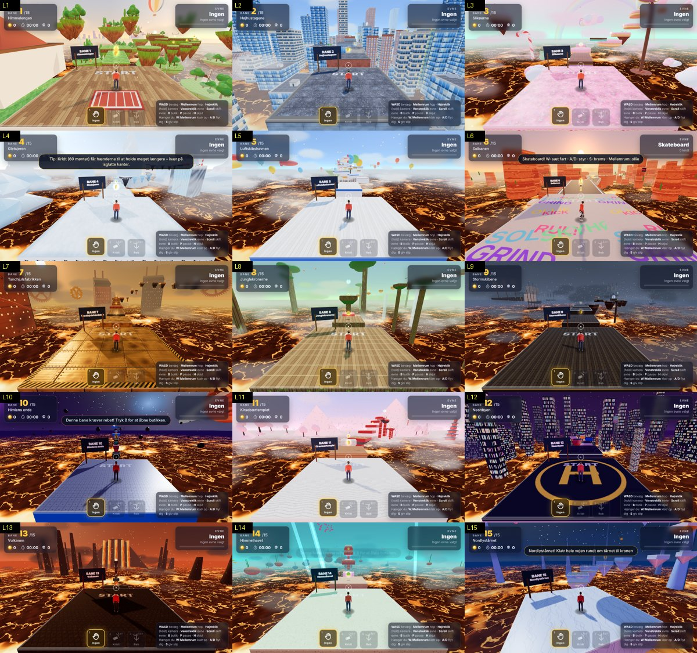

---

## Indhold

- [Spil det](#spil-det)
- [Styring](#styring)
- [Hænderne, dobbelthop og skateboard](#hænderne-dobbelthop-og-skateboard)
- [Mønter, butik og kontrolpunkter](#mønter-butik-og-kontrolpunkter)
- [De 15 baner](#de-15-baner)
- [Byggedagbog – billeder fra hele processen](#byggedagbog--billeder-fra-hele-processen)
- [Teknisk overblik](#teknisk-overblik)
- [Tests](#tests)

---

## Spil det

Spillet består af tre filer: **`index.html`**, **`style.css`** og **`game.js`**.

1. **Dobbeltklik på `index.html`**. Det virker direkte fra disken (`file://`).
2. Eller kør en lokal webserver i mappen, f.eks. `npx serve .` eller `python3 -m http.server`, og åbn adressen.

Første gang siden åbnes, skal der være internetforbindelse. Three.js `0.160.0` og cannon-es `0.20.0` hentes nemlig fra jsDelivr-CDN'en via et *import map*. Spillet kræver en moderne browser med WebGL (Chrome, Edge, Firefox eller Safari 16.4+). Fremskridt, mønter og køb gemmes automatisk i browseren. Når du har klaret en bane, kan du også vælge den direkte fra hovedmenuen under **Vælg bane**.


## Styring

| Tast / mus | Handling |
|---|---|
| **W A S D** | Bevæg dig i forhold til kameraets retning |
| **Mellemrum** | Hop. Hold for et højere hop. Ejer du **dobbelthop**, kan du trykke igen i luften |
| **Højreklik (hold)** | Drej kameraet og se dig omkring |
| **Q / E** | Drej kameraet med tastaturet |
| **Venstreklik** | Brug den valgte evne (kridt eller reb) |
| **Scrollhjul** eller **1 / 2 / 3** | Skift evne |
| **B** | Butik |
| **P** / **Esc** | Pause |
| **R** | Genstart banen |
| **M** | Lyd til/fra |
| **H** | Skjul/vis hjælpelinjen |

**Når du hænger i hænderne:**

| Tast | Kant | Stang | Svævebane |
|---|---|---|---|
| **W** / **Mellemrum** | Klatr op | Mellemrum: spring videre i den retning, du kigger | Mellemrum: hop af |
| **A / D** | Flyt dig sidelæns langs kanten | Flyt dig hånd over hånd | – |
| **S** | Giv slip | Giv slip | – |

**På skateboard (bane 6):** **W** sætter fart, **A/D** styrer, **S** bremser, og **mellemrum** laver en ollie. Lander du på et rækværk, grinder du automatisk hen ad det.

**Med rebet:** Venstreklik skyder rebet mod et lysende krogpunkt. *Hold* venstreklik for at hale dig ind. **W** giver svinget fart, og **mellemrum** hopper af med et ekstra løft.

## Hænderne, dobbelthop og skateboard

**Hænderne griber selv.** Hopper du mod en kant, der er lidt for høj eller lidt for langt væk, griber løberen fat med hænderne. Det gælder også stænger, lianer, trapezer, svævebaner og rebstiger. Derfor kan hop med greb være meget længere end hop, hvor du skal lande på fødderne:

| Højdeforskel | Kun fødderne | Med greb i kanten |
|---|---|---|
| Samme højde | 7,75 m | **10 m** |
| 1 m op | 6,75 m | **9,25 m** |
| 2 m op | 5 m | **8,75 m** |
| 3 m op | umuligt | **7,75 m** |

Alle tal er målt med spillets rigtige fysik (se [`docs/udvikling/MEASURED.md`](docs/udvikling/MEASURED.md)). Mens du hænger, tømmes **grebsmåleren** (GREB) på cirka 4 sekunder ved en kant og cirka 5,5 sekunder i en stang. Det koster ekstra greb at flytte sig, og våde eller isglatte kanter tærer dobbelt så hurtigt. Når måleren er tom, glider hænderne. Står du på fast grund, fyldes den igen.

**Kridt virker kun på hænderne.** Venstreklik med kridt fylder grebet op. I 8 sekunder holder grebet derefter fire gange så længe, og hænderne når kanter længere væk. Kridt gør dig ikke hurtigere og får dig ikke til at hoppe højere.

**Dobbelthop** (købes i butikken) giver et ekstra hop i luften, og du kan skifte retning i det. Et dobbelthop rækker op til ca. 14 m, og med greb i enden ca. 16 m. Fra bane 11 er det påkrævet.

**Skateboardbanen** (bane 6, Solbanen) køres helt på skateboard med ramper, rækværk at grinde på og fartstriber, der skyder dig fremad.

| Kantgreb på fyrtårnet (bane 5) | I en stang på stilladset (bane 2) |
|---|---|
| 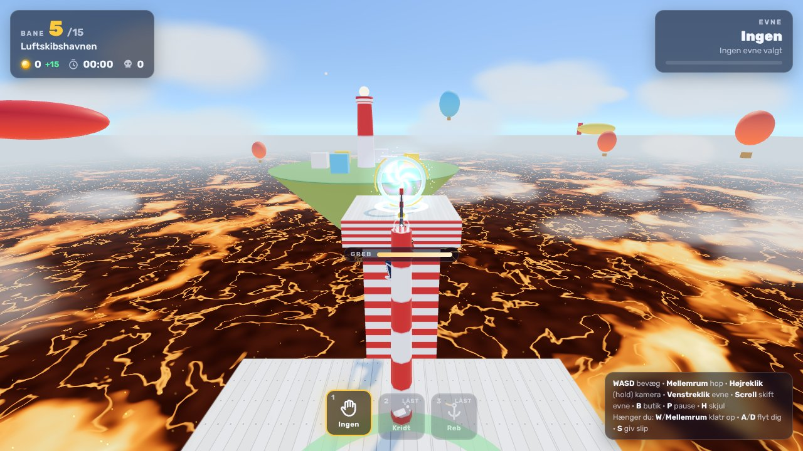 | 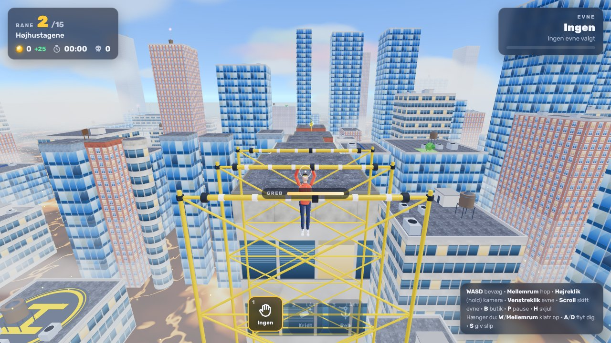 |
| **Skateboard på Solbanen (bane 6)** | **Iskant på gletsjeren (bane 4)** |
| 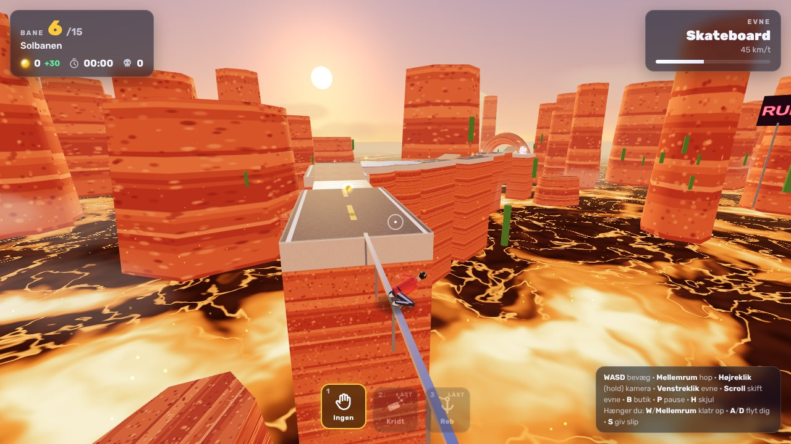 | 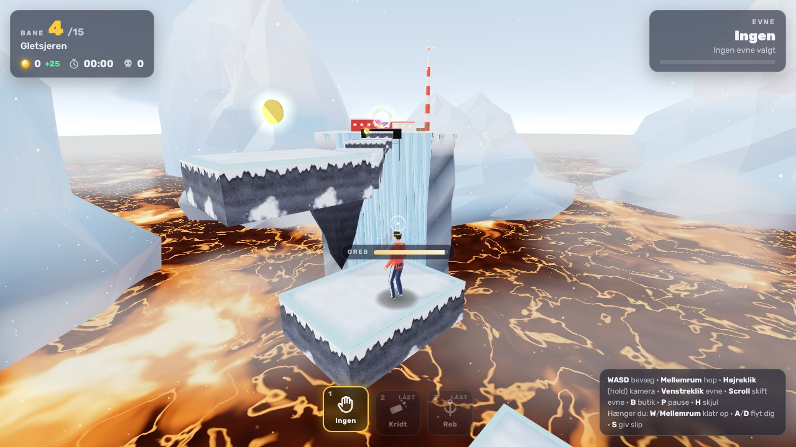 |

## Mønter, butik og kontrolpunkter

Når du når portalen for enden af en bane, får du **mønter**: fra 20 på bane 1 til 100 på bane 15. Undervejs kan du samle **bonusmønter** til 5 mønter stykket. Alle mønter udbetales ved portalen.

Hver bane har 1–5 **kontrolpunkter**. Det er de platforme, der har en lys ring, og ringen bliver grøn, når du lander på den. Rører du lavaen, starter du igen fra det seneste kontrolpunkt, og de mønter, du allerede har samlet, beholder du. Trykker du **R**, starter banen helt forfra.

| Vare | Type | Pris | Effekt |
|---|---|---|---|
| **Kridt** | Evne | 60 | Frisk kridt på hænderne. Grebet fyldes op, og i 8 s holder det 4× så længe og griber kanter længere væk. Genoplades på 12 s |
| **Dobbelthop** | Evne | 120 | Tryk mellemrum igen i luften. **Kræves fra bane 11** |
| **Reb (entrehage)** | Evne | 150 | Skyd rebet mod et lysende krogpunkt og sving dig over kløfter. **Kræves fra bane 8** |
| **Klatrehandsker** | Opgradering | 90 | Grebet holder 50 % længere, når du hænger i kanter og stænger |
| **Kridtpose** | Opgradering | 100 | Kridtet genoplades dobbelt så hurtigt (6 s). Kræver kridt |
| **Langt reb** | Opgradering | 160 | Rebets rækkevidde øges fra 32 m til 45 m. Kræver reb |

Butikken åbnes mellem banerne, fra pausemenuen, fra hovedmenuen eller med **B** midt i en bane.

| Bane fuldført | Butikken |
|---|---|
|  |  |

## De 15 baner

Hver bane har sin egen verden med egne platforme, egen pynt og egen himmel. Under det hele ligger lavahavet. Rører du det, mister du banen, eller du starter fra det seneste kontrolpunkt. Hver bane ender i en **glødende portal**.

| # | Navn | Verden | Nyt / særligt | Kræver | Mønter |
|---|---|---|---|---|---|
| 1 | **Himmelengen** | Svævende græsøer med træer, får og luftballon | Store platforme og lette hop. Den første stang at gribe | – | 20 |
| 2 | **Højhustagene** | Skyskrabertage, vandtårne og helikopterplads | **Kantgreb**: hop der kun kan klares med hænderne. Stilladsstænger og en svævebane | Hænderne | 25 |
| 3 | **Slikøerne** | Chokoladeplader, lagkager, slikstokke og skumfiduser | **Springpuder**, **smuldrende kiks** og slikstokstænger | Hænderne | 30 |
| 4 | **Gletsjeren** | Isflager, istapper og frosne isfald | **Glatis**, **isglatte kanter**, der tærer på grebet, og roterende isflager | Hænderne (kridt anbefales) | 35 |
| 5 | **Luftskibshavnen** | Moler, balloner og et rød-hvidt fyrtårn | **Bevægelige** færgedæk og ballonkurve, der stiger og falder | Hænderne | 40 |
| 6 | **Solbanen** | Ørkenmesa ved solnedgang | **Skateboard**: ramper, rækværk til grind og fartstriber | – | 45 |
| 7 | **Tandhjulsfabrikken** | Messingtandhjul, rør og et klokketårn | **Drejeskiver**, **transportbånd** og **dampventiler**, der løfter dig | Hænderne | 50 |
| 8 | **Junglekronerne** | Trækroner, lianer og vandfald | **Rebet** og krogpunkter. Lianetrapezer og svævebane | Reb, hænderne | 55 |
| 9 | **Stormskibene** | Flyvende sejlskibe i et uvejr | Gyngende dæk, våde og glatte rælinger og en ræstige med rå-stænger | Reb, hænderne | 60 |
| 10 | **Himlens ende** | Stjernehimmel og meteorer | Smuldrende meteorer og lange rebkløfter med flere krogpunkter | Reb, hænderne | 70 |
| 11 | **Kirsebærtemplet** | Pagoder, torii-porte og kirsebærtræer | Rækker af røde stænger og huller, der kun kan klares med **dobbelthop** | Reb, dobbelthop | 75 |
| 12 | **Neonbyen** | Neonskyskrabere om natten | Transportbånd, en ventil, der løfter dig, og bevægelige stænger | Reb, dobbelthop | 80 |
| 13 | **Vulkanen** | Basaltsøjler og lavafald | Bevægelige sten, smuldrende basalt, en ventil og en springpude | Reb, dobbelthop | 85 |
| 14 | **Himmelhavet** | Hvalskeletter, skildpadder og koraller i skyerne | 13 stænger i hvalribben, vindstrøm og springpuder | Reb, dobbelthop | 90 |
| 15 | **Nordlystårnet** | Krystaltårn under nordlyset | Finalen: klatr hele vejen rundt om tårnet til kronen, med lysekroner, trapez og alt det andet | Reb, dobbelthop | 100 |

"Hænderne" betyder, at banen har mindst ét hop, der ikke kan klares uden kantgreb. Det har testrobotten bevist ved at spille banen med kantgreb slået fra (se [Tests](#tests)).

| Bane 3 – slikstokstang | Bane 7 – drejeskiver |
|---|---|
| 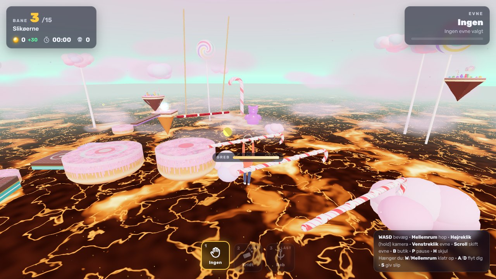 | 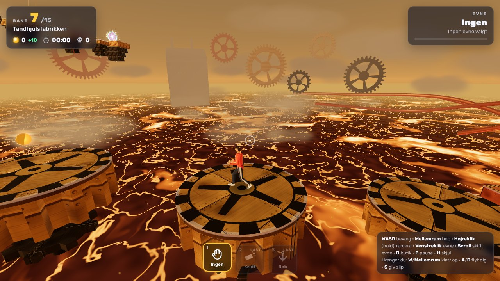 |
| **Bane 8 – lianer** | **Bane 9 – stormskibenes ræling** |
| 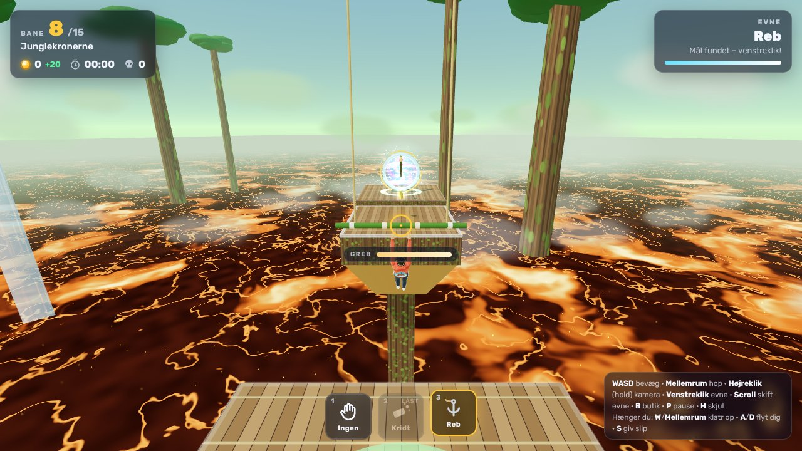 | 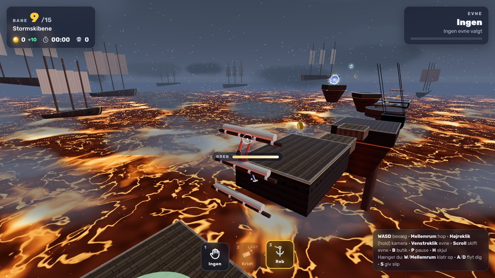 |
| **Bane 11 – tempelstænger** | **Bane 13 – vulkanen** |
| 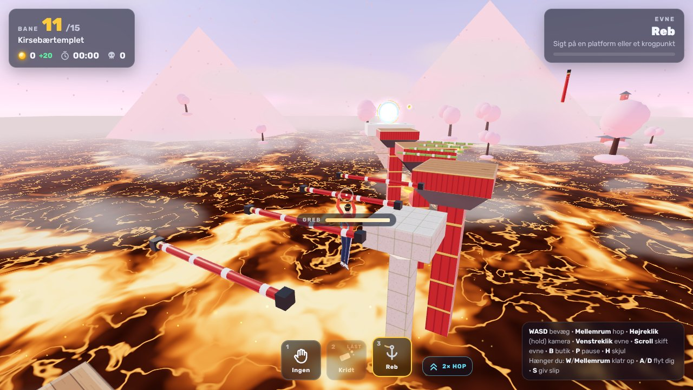 | 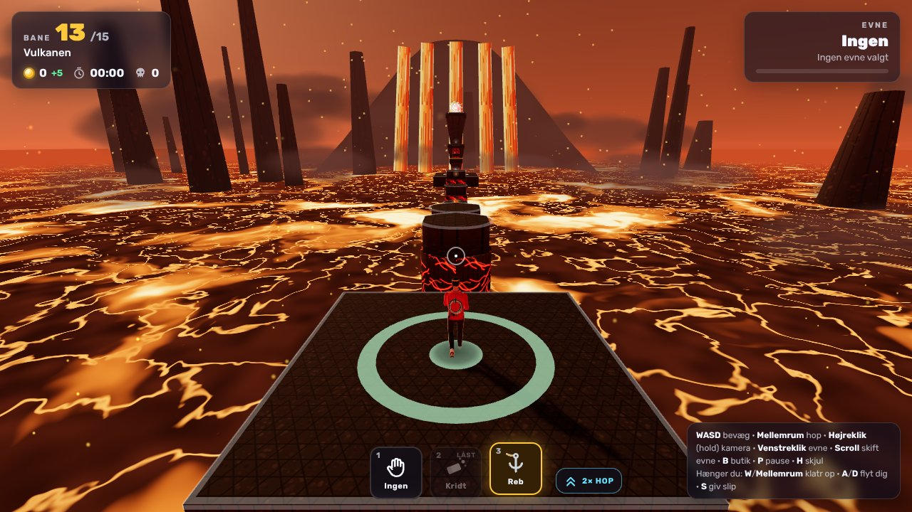 |
| **Bane 14 – hvalribben** | **Bane 15 – lysekronerne** |
| 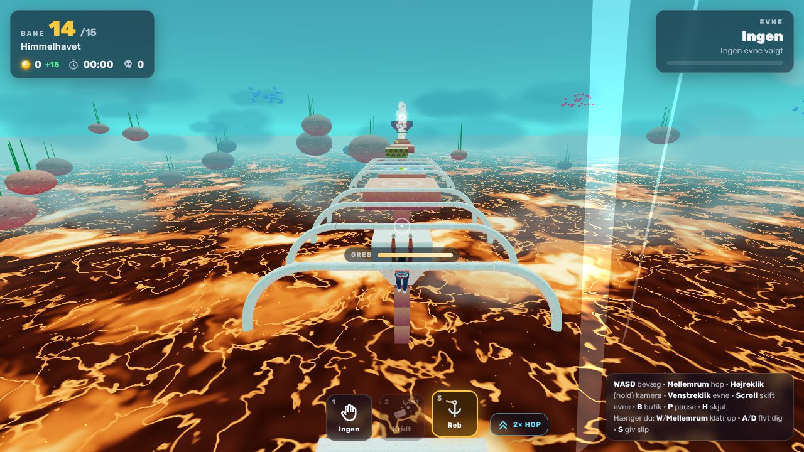 | 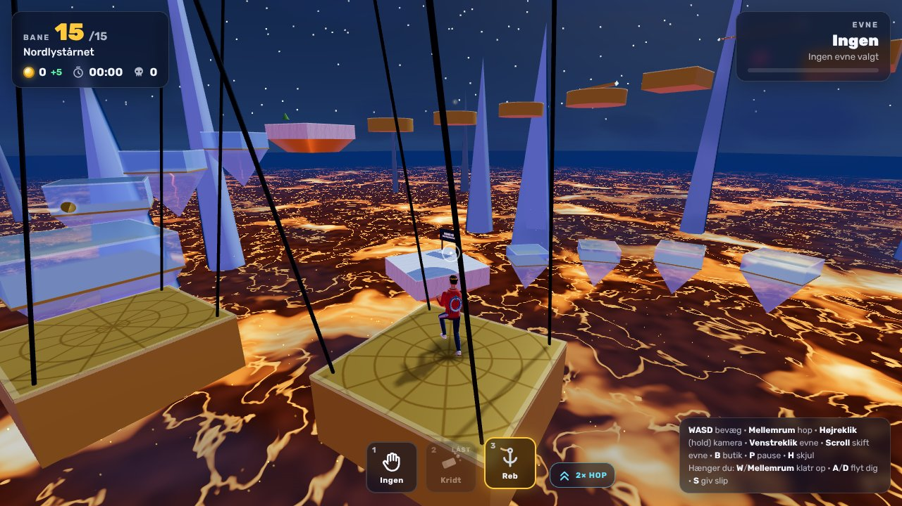 |

Startudsigten og et perspektiv fra cirka en tredjedel inde på banen findes for alle 15 baner i [`docs/images`](docs/images) (`bane-01-start.jpg` … `bane-15-oversigt.jpg`).

---

## Byggedagbog – billeder fra hele processen

Spillet er bygget i to omgange. Begge blev dokumenteret med skærmbilleder, som blev taget automatisk i en headless browser.

### Version 2 – realistisk løber, hænder og 15 verdener

Ønskerne til version 2 var:

- en mere realistisk løber
- mere forskellige baner, og ikke kun sten
- længere hop, hvor hænderne skal gribe og holde fast
- dobbelthop i butikken
- kridt, der kun hjælper hænderne
- fem nye baner (15 i alt), hvoraf én køres på skateboard

#### Løberen

Den gamle figur var bygget af kasser og cylindre. Den nye løber er 1,80 m høj med rigtige proportioner. Han består af 56 dele: hofte, ryg, bryst, nakke og hoved, skulderblade, over- og underarme og hænder med tommel og fire fingre med to led hver, lår, skinneben, fødder og tæer.

- **Bevægelser:** Alle fire lemmer styres med *inverse kinematik* (IK). Det betyder, at hænder og fødder placeres præcist på kanter, stænger, rebet og skateboardet, og så regnes armene og benene ud derfra.
- **Løb:** I løbecyklussen glider fødderne ikke. Skridtlængden følger farten, og hælen løftes, mens tåen ruller af. Hoften vipper, armene svinger modsat benene, og kroppen læner sig ind i svingene.
- **I hvile:** Han trækker vejret, og tungere efter en klatretur. Han flytter vægten fra ben til ben og kigger sig omkring.

| Før | Efter: løb, hop, hænder, skateboard, rebet og salto |
|---|---|
| 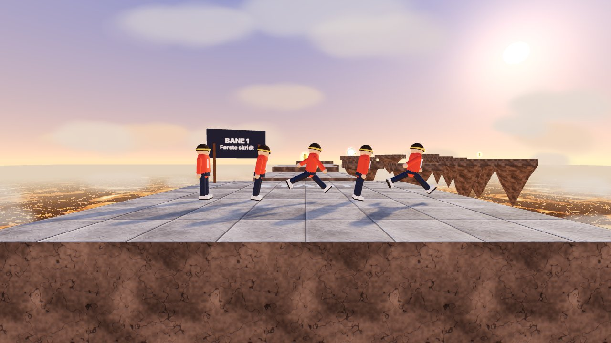 | 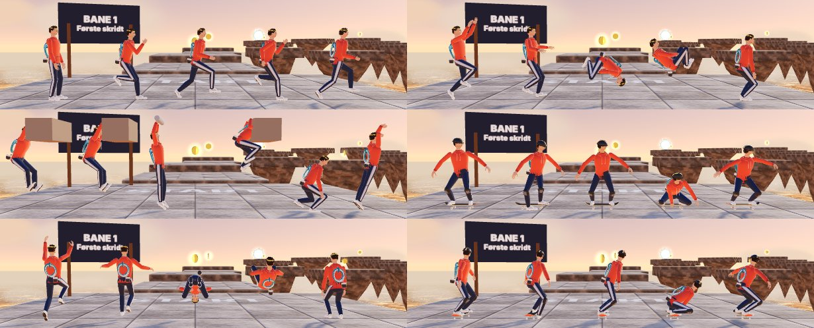 |

#### Verdenssæt i stedet for sten

I version 1 var alle platforme stenblokke med takket klippe under. Nu har hver bane sit eget **verdenssæt**: en fil, der bygger banens platforme, stænger, svævebaner og krogpunkter, og som pynter verden omkring dem.

- **Platforme:** f.eks. chokoladeplader og lagkager, isflager med istapper, færgedæk og ballonkurve, messingtandhjul, skibsdæk, pagodetage, neontage, basaltsøjler, hvalribben og krystaller.
- **Pynt:** skyskrabere, luftskibe, tandhjul, sejlskibe, kirsebærtræer, vulkaner og nordlys.

De 15 sæt deler en fælles værktøjskasse (`_lib.js`) med teksturer, materialer og former. Hvert sæt blev fotograferet fra flere vinkler og rettet, før banerne blev bygget.

| Før: alle platforme var sten | Efter: 15 forskellige verdener |
|---|---|
| 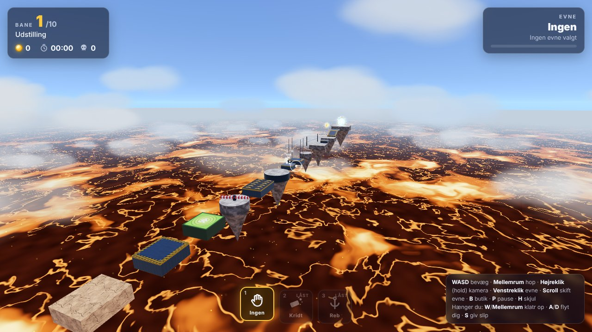 |  |

#### Nye mekanikker i motoren

- **Hænderne:**
  - kantgreb med klatring op og sidelæns
  - stænger hånd over hånd og spring fra stang til stang
  - trapezer, svævebaner (zip-lines) og ræstiger
  - grebsmåler, isglatte kanter og klatrehandsker
- **Dobbelthop**, med retningsskift i luften.
- **Skateboard:**
  - fart, styring, ollie og grind på rækværk
  - ramper og fartstriber
- **Nye platformtyper:**
  - drejeskiver og roterende platforme
  - transportbånd og dampventiler, der løfter dig
  - vindstrøm og springpuder i flere styrker
  - bevægelige platforme og stænger af alle slags
- **Kontrolpunkter**, så man ikke skal starte forfra efter hvert fald.

| Dampventil i tandhjulsfabrikken (bane 7) | Springpude på slikøerne (bane 3) |
|---|---|
| 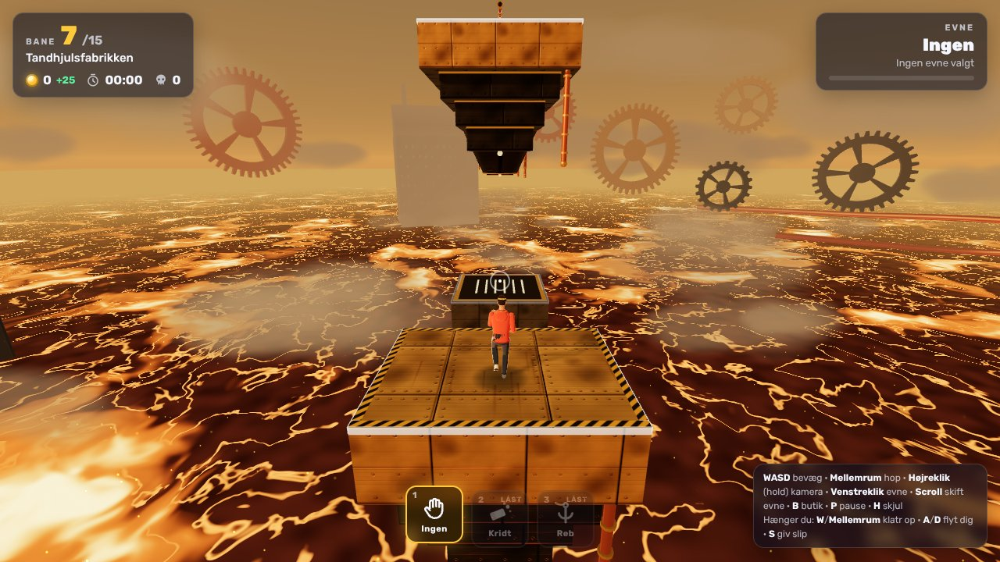 | 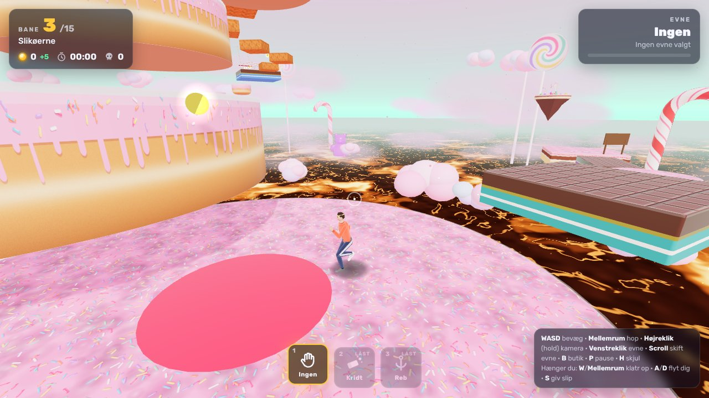 |

#### Banerne blev designet med målinger og spillet af en robot

Først blev spillets grænser målt med den rigtige fysik: hoplængder med og uden greb, med og uden dobbelthop, og hvor langt springpuder, ventiler og stænger rækker. Tallene ligger i [`docs/udvikling/MEASURED.md`](docs/udvikling/MEASURED.md). Hver bane blev derefter beskrevet som en liste af segmenter, f.eks. `{ g: 9, dy: 1, grab: true }` for "et hul på 9 m, 1 m op, kun med kantgreb".

En **planlægningsrobot** spiller hver bane fra start til portal med spillets rigtige fysik og rigtige tastetryk. Den prøver varianter af hvert hop:

- tilløb
- timing
- dobbelthop
- slip-tidspunkt fra stænger og reb

Med gem/gendan af hele simulationen kan den gå tilbage og prøve igen. For hver bane kontrollerer robotten:

1. Banen **kan** gennemføres med det udstyr, banen kræver.
2. Banen **kan ikke** gennemføres uden rebet eller dobbelthoppet, hvis banen kræver det.
3. Banen **kan ikke** gennemføres uden kantgreb, når den skal kræve hænderne.

Robotten fandt mange problemer undervejs, som blev rettet:

- for lange hop
- stænger, man fløj forbi
- et smuldrende stykke, der faldt for tidligt
- et tagudhæng, der skjulte en kant
- baner, hvor man kunne snyde sig uden om hænderne

Bane 9, 13 og 14 blev strammet, så de kræver det, de skal.

| Bane 2 – tagene i storbyen | Bane 5 – ballonkurvene ved havnen |
|---|---|
|  | 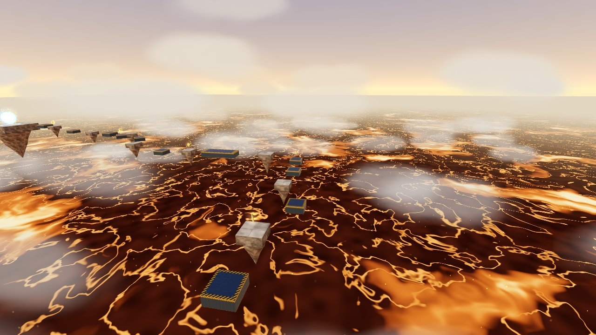 |
| **Bane 12 – Neonbyen** | **Bane 15 – Nordlystårnet** |
| 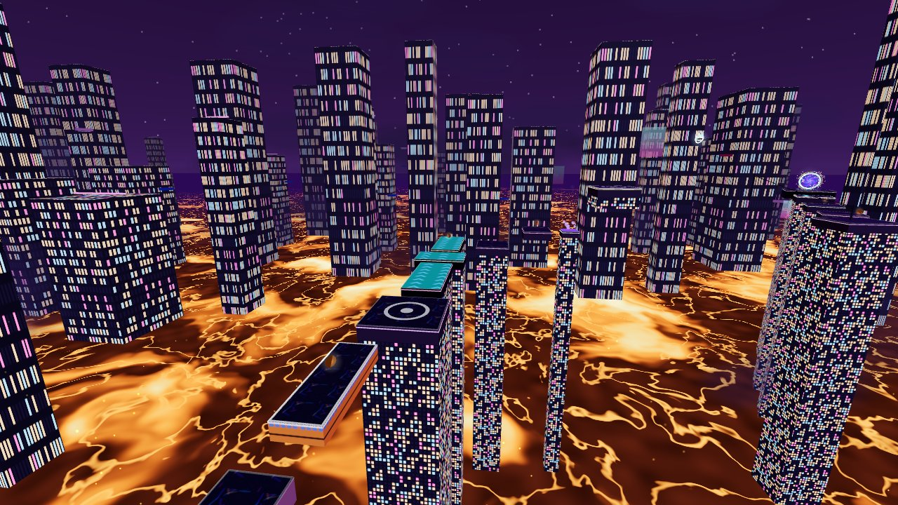 | 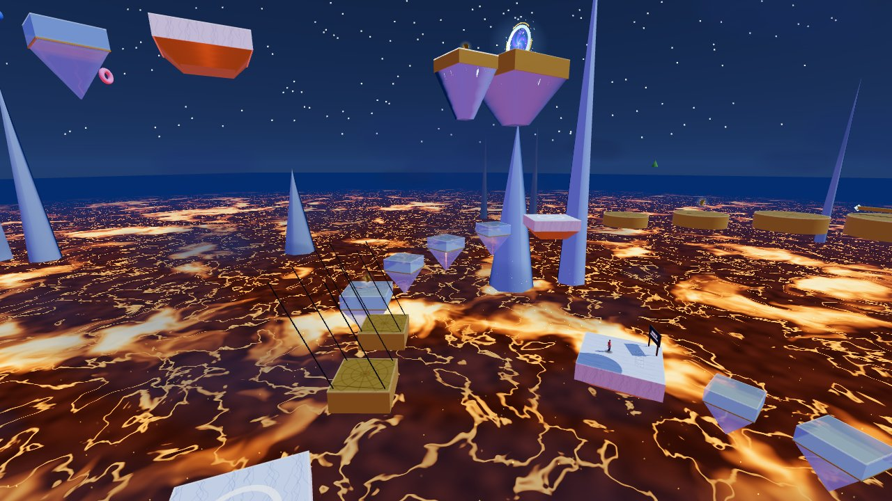 |

| Portalen | Død i lavaen |
|---|---|
|  |  |
| **Pause** | **Alle 15 baner gennemført** |
|  |  |

### Version 1 – himlen, lavaen, rebet og de første 10 baner

Den første version byggede fundamentet. Det meste af det er stadig med, men banerne og figuren er skiftet ud.

**Miljøet** består af:

- en gradient-himmel med sol eller måne og procedurelle skyer
- en animeret lava-shader med mørk skorpe, glødende revner og gløder, der stiger op
- retningsbestemt sollys med bløde skygger

Alle teksturer tegnes på `<canvas>` ved opstart, så der er ingen eksterne billedfiler.

| Morgen | Solnedgang | Nat |
|---|---|---|
|  |  |  |

**Evnerne og mekanikkerne** fra version 1:

- **Rebet** er en uelastisk afstandsbegrænsning, så man svinger som et ægte pendul.
- **Bevægelige platforme** giver deres fart videre til spilleren.
- **Smuldrende sten** ryster og falder.
- **Springpuder** sender en højt op.

| Rebet låser på et krogpunkt | Midt i et sving |
|---|---|
|  |  |
| **Bevægelige platforme** | **Springpude** |
|  |  |


Testene fra version 1 fandt allerede dengang reelle fejl:

- rebet halede sig selv ind
- sidelæns fart fra bevægelige platforme kunne ikke styres
- vindmøller var for hurtige
- portalen var helt hvid

| Før: sigte mod et højt krogpunkt | Efter: automatisk lås |
|---|---|
|  |  |

---

## Teknisk overblik

```
index.html   Import map (Three.js + cannon-es fra CDN), HUD og alle menuskærme
style.css    HUD, hotbar, grebsmåler, menuer, butik, banevalg (glas-look, responsivt)
game.js      Hele spillet i én fil (ca. 12.800 linjer). Den BYGGES af src/ – ret aldrig i den direkte
src/motor     Motoren, ét afsnit pr. fil:
               00 Start                  09b Verdenssæt-systemet
               01 Konfiguration          10  Baneobjekter i drift (bevægelige, drejeskiver, ventiler …)
               02 Danske tekster         11  Spilleren (fysik, hænder, dobbelthop, skateboard)
               03 Himmel-temaer          12  Input
               04 Banernes format        13  Kamera
               05 Hjælpefunktioner       14  Evner (kridt og reb)
               06 Teksturer              15  Lyd (procedurel WebAudio)
               07 Himmel, lava, lys      16  Brugerflade
               08 Fysikverden            17  Gem / indlæs
               09 Banebygger             18  Spiltilstand og hovedløkke
src/baner     De 15 baner som data (L01.json … L15.json)
src/verdener  De 15 verdenssæt + fælles værktøjskasse (_lib.js)
src/figur     Løberen (figur.js)
tools/byg.js  Samler src/ til game.js
docs/images     Skærmbilleder brugt i denne README
docs/udvikling  Specifikationer, målinger og designnoter fra udviklingen
tests/          Testrobot, end-to-end-test og skærmbillede-scripts
CLAUDE.md       Arbejdsgang og projektkort for Claude (og andre udviklere)
```

**Byg spillet efter en ændring i `src/`:** `node tools/byg.js`. Det skriver `game.js`, som committes sammen med ændringen, så spillet stadig kan startes med et dobbeltklik på `index.html`. `node tools/byg.js --tjek` fejler, hvis `game.js` ikke svarer til `src/`. Det tjekker GitHub også ved hver ændring.

- **Fysikken:**
  - Tidsskridtet er fast: 1/120 s.
  - Tyngdekraften er 24 m/s², løbefarten 9 m/s og hoppet 10,5 m/s.
  - Hænderne er ikke fysiklegemer. Bevægelseskoden finder i stedet kanter og stænger inden for rækkevidde i hvert skridt og låser hænderne fast på dem.
- **Stramme kontroller:**
  - *Coyote time:* man kan hoppe 0,11 s efter at have forladt en kant.
  - En hop-buffer og variabel hophøjde.
  - En rund skygge under spilleren, der viser, hvor man lander.
- **Verdenssæt:** Hvert sæt registrerer sig som `window.SKYHOJ_KITS[id]` og leverer funktioner, der bygger platforme, stænger, svævebaner, krogpunkter og pynt. Banen beskriver kun *hvor* tingene er. Verdenssættet bestemmer, *hvordan* de ser ud. Kildefilerne ligger i [`src/verdener`](src/verdener).
- **Lyd:** Alle lydeffekter syntetiseres med WebAudio, så der er ingen lydfiler.
- **Virker fra disken:** `index.html` indlæser bibliotekerne som ES-moduler og starter derefter `game.js` som et klassisk script, fordi browsere blokerer lokale modulfiler under `file://`.
- **Udvikler-hooks:** Med `?debug` i adressen får testene adgang til `window.skyhoj`. Det giver bl.a. gem/gendan af hele simulationen, frys og fri kamera.

## Tests

Testene kører spillet i headless Chromium (WebGL via software-rendering). CDN-adresserne besvares med lokale kopier af præcis de samme biblioteksversioner, så testene også kører offline.

```bash
cd tests
npm install
npm run baner       # robotten spiller alle 15 baner og tjekker kravene (reb, dobbelthop, hænder)
npm run e2e         # rigtige mus-/tastaturhændelser end-to-end (36 kontroller)
npm test            # begge dele
npm run billeder    # startudsigt og perspektiv for alle 15 baner til docs/images
npm run skaerme     # portal, lavadød, menu, butik, pause og sejr til docs/images
```

Slutresultat af `npm run baner`:

```
Bane  1 Himmelengen          BESTÅET
Bane  2 Højhustagene         BESTÅET   uden kantgreb: umulig ✓
Bane  3 Slikøerne            BESTÅET   uden kantgreb: umulig ✓
Bane  4 Gletsjeren           BESTÅET   uden kantgreb: umulig ✓
Bane  5 Luftskibshavnen      BESTÅET   uden kantgreb: umulig ✓
Bane  6 Solbanen             BESTÅET   (skateboard)
Bane  7 Tandhjulsfabrikken   BESTÅET   uden kantgreb: umulig ✓
Bane  8 Junglekronerne       BESTÅET   uden reb: umulig ✓   uden kantgreb: umulig ✓
Bane  9 Stormskibene         BESTÅET   uden reb: umulig ✓   uden kantgreb: umulig ✓
Bane 10 Himlens ende         BESTÅET   uden reb: umulig ✓   uden kantgreb: umulig ✓
Bane 11 Kirsebærtemplet      BESTÅET   uden dobbelthop: umulig ✓
Bane 12 Neonbyen             BESTÅET   uden dobbelthop: umulig ✓
Bane 13 Vulkanen             BESTÅET   uden dobbelthop: umulig ✓
Bane 14 Himmelhavet          BESTÅET   uden dobbelthop: umulig ✓
Bane 15 Nordlystårnet        BESTÅET   uden dobbelthop: umulig ✓
End-to-end: 36/36 kontroller OK – ingen JavaScript-fejl
```

Testene køres også automatisk på GitHub ved hvert push og hver pull request (se [`.github/workflows/test.yml`](.github/workflows/test.yml)): byggetjek, e2e og robotten fordelt på tre parallelle job med fem baner hver.

Se [`tests/README.md`](tests/README.md) for detaljer.
